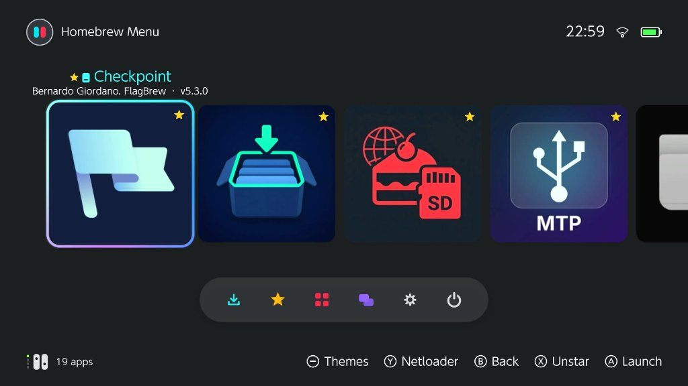
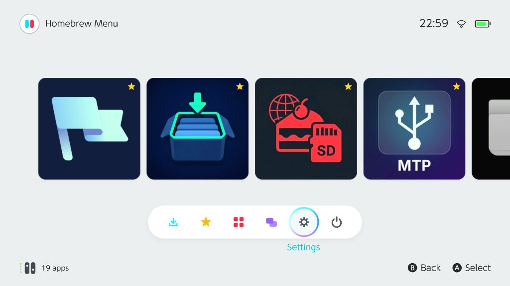
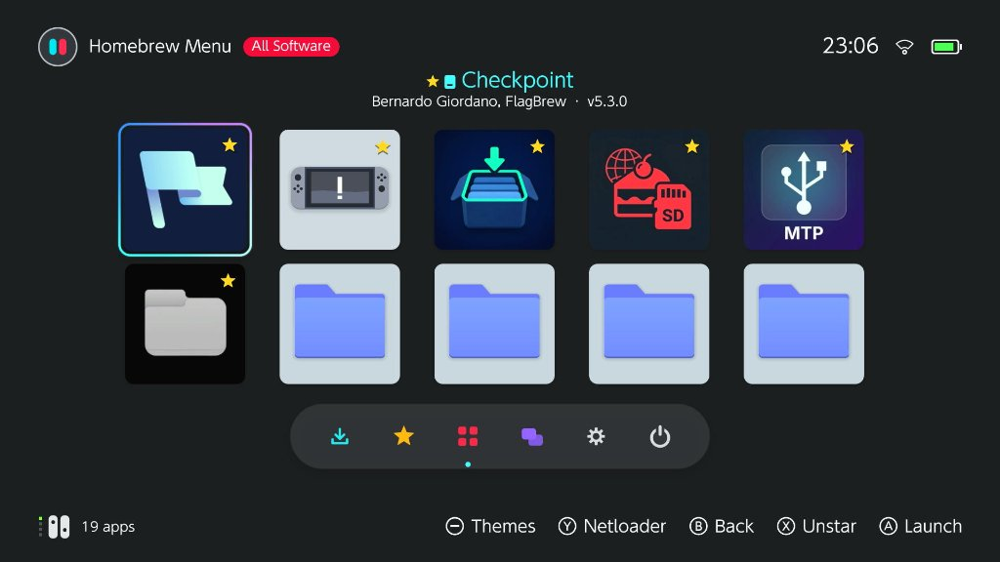
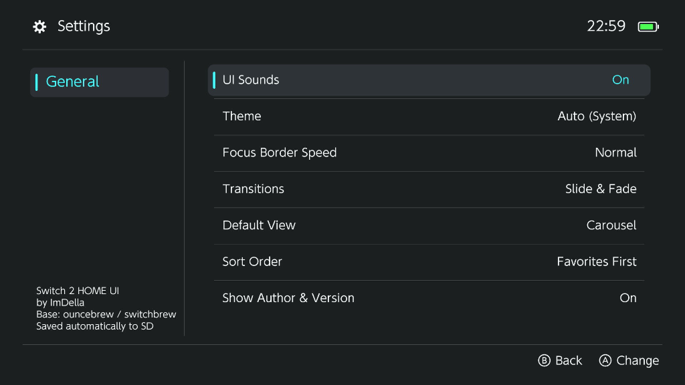

<p align="center">
  
</p>

<h1 align="center">Homebrew Menu — Switch 2 HOME UI</h1>

<p align="center">
  A Nintendo Switch 2 HOME-style frontend for <strong>ounce-hbmenu</strong> (Switch 2 / kaiHEN), rendered natively on the GPU via Vulkan (OunceVK) at 1080p handheld and up to 4K docked at 60 fps.
</p>

---

## Screenshots

| Basic Dark (Carousel) | Basic Light (Pill Focus) |
| :---: | :---: |
|  |  |
| **All Software (Grid)** | **Switch 2 Settings** |
|  |  |

---

## Features

* **Authentic Switch 2 HOME Layout**
  * **1-Row Carousel** with large rounded app tiles, soft elevation shadows, elastic selection pop, and a **360° continuous iridescent focus border** (`256×256` SDF ring).
  * **All Software Grid** (5-column scrollable grid) accessible from the end of the carousel or the bottom pill bar.
  * **Interactive Bottom Pill Bar** with clean vector/SDF icons for **Netloader**, **Favorites** (quick filter), **All Software**, **Themes**, **Settings**, and **Exit**.
  * **Clean Switch 2 HUD**: circular header badge, clock (`HH:MM`), accurate **Wi-Fi / Airplane Mode** detection, horizontal live battery indicator, and Joy-Con P1 footer icon.
* **Full-Screen Switch 2 Sidebar Settings** (`General` / `Appearance` / `Audio`)
  * **General:** Default View (`Carousel` / `All Software`), Sort Order (`Favorites First` / `Alphabetical`), Show Author & Version, **Battery Percentage** (`On` / `Off`), **Clock Format** (`24-Hour` / `12-Hour`), Transitions (`Slide & Fade` / `Fade` / `Instant`), and **Reset to Defaults** (with confirmation).
  * **Appearance:** Theme (`Auto` / `Basic Light` / `Basic Dark`), **Custom Wallpapers** (`JPG` / `PNG`) with adjustable **Dimming** (`0%–80%`), Focus Border Speed (`Slow` / `Normal` / `Fast` / `Static`), **Focus & Accent Color Presets** (`Iridescent`, `Neon Cyan`, `Switch 2 Red`, `Electric Violet`, `Gold`, `Emerald`, `Custom RGB`) + **R/G/B Sliders**, and a **Live Preview Card**.
  * **Audio:** UI Sounds (`On` / `Off`), **Custom `.zip` Sound Packs** (with instant preview & automatic fallback to built-in Switch 2 SFX), **SFX Volume**, **Streaming BGM** (`WAV` / `MP3` / `OGG` + `Random` + `Sound Pack BGM`), **BGM Volume**, and smooth launch fade-out paired with a Switch 2 app launch animation.
  * **Auto-Folders & Auto-Rescan:** Required SD folders are created automatically on first launch and rescanned whenever you open Settings.
* **Full Gamepad & Touchscreen Support**
  * Horizontal touch drag on the carousel, tap to select/launch, tap pill icons directly, and touch navigation in Settings.
* **Non-Destructive Configuration**
  * Settings are stored in a dedicated file (`sdmc:/config/nx-hbmenu/switch2_settings.cfg`) and never touch upstream `nx-hbmenu`'s `settings.cfg`.

---

## Controls

| Input | Action |
| :--- | :--- |
| **D-Pad / Left Stick** | Navigate apps, grid, pill bar, or settings |
| **Down** *(on carousel / last grid row)* | Move focus to the bottom pill bar |
| **Up / B** *(on pill bar)* | Return focus to apps |
| **A** | Launch app / Open folder / Apply theme / Select pill item |
| **B** | Back (exit Settings, Grid, Favorites filter, Theme Menu, or subfolder) |
| **X** | Star / Unstar favorite app |
| **Y** | Start Netloader (`nxlink`) |
| **- (Minus)** | Open Theme Menu |
| **ZL / ZR** | Fast page jump |
| **+ (Plus)** | Exit Homebrew Menu |

---

## Custom Wallpapers, BGM & Sound Packs

On first launch, Homebrew Menu automatically creates these folders on your microSD card:

| Feature | Folder on microSD | Supported Formats |
| :--- | :--- | :--- |
| **Wallpapers** | `sdmc:/config/nx-hbmenu/wallpapers/` | `.jpg`, `.jpeg`, `.png` (auto-scaled up to 1080p) |
| **Background Music** | `sdmc:/config/nx-hbmenu/bgm/` | `.wav`, `.mp3`, `.ogg` (looped streaming) |
| **Sound Packs** | `sdmc:/config/nx-hbmenu/sfx/` | `.zip` archives (no need to extract) |

### Creating a `.zip` Sound Pack
Place your `.wav` files in the root of a `.zip` archive (or inside a `sounds/` subfolder). Any missing sound automatically falls back to the built-in Switch 2 tactile SFX:

| UI Event | Supported Filenames (case-insensitive) |
| :--- | :--- |
| **Cursor Move** | `move.wav`, `cursor_move.wav`, `cursor.wav`, `tick.wav` |
| **Pill / Settings Move** | `pill.wav`, `dock_enter.wav`, `options.wav`, `cursor_move.wav` |
| **Confirm / Select** | `confirm.wav`, `enter_menu.wav`, `ok.wav`, `select.wav` |
| **Back / Cancel** | `back.wav`, `cancel.wav`, `back_menu.wav` |
| **Star / Favorite** | `star.wav`, `notification.wav`, `favorite.wav` |
| **App Launch** | `launch.wav`, `startup.wav` |
| **Optional Pack BGM** | `bgm.wav`, `bgm.mp3`, `bgm.ogg` |

---

## Installation (Switch 2 / kaiHEN)

1. Download `hbmenu.nro` from the [Releases](https://github.com/ImDella/Switch2-HBmenu-Home/releases/latest) page.
2. *(Optional)* Download **`Switch2-HBmenu-StarterPack.zip`** from the same release and extract it to the root of your microSD card to get ready-to-use wallpapers, BGM, and `.zip` sound packs.
3. Back up your existing `sdmc:/hbmenu.nro` (e.g. rename it to `hbmenu_backup.nro`).
4. Copy the new `hbmenu.nro` to the root of your microSD card (`sdmc:/hbmenu.nro`).
5. Launch any game while holding **`R`** under **kaiHEN** to boot into Homebrew Menu.

---

## Building from Source

Requires **devkitPro** (`devkitA64`) with the **[ounce-devkit](https://github.com/ouncebrew/ounce-devkit)** (`libounce`, `ouncevk`, `libkaihen`), **Python 3**, and **`glslangValidator`** (`glslang`).

### Required `dkp-pacman` packages
* `switch-dev`
* `switch-freetype`
* `switch-libconfig`
* `switch-libjpeg-turbo`
* `switch-libpng`
* `switch-libvorbis`
* `switch-minizip`
* `switch-physfs`

### Compile
From the repository root:

```sh
make -f switch2/Makefile
```

The compiled binary is written to `build/nro/nro/hbmenu.nro`.

Alternatively, build inside Docker using the included `Dockerfile`:

```sh
docker build --output out .
```

---

## Disclaimer

This software is provided **"as is"**, without warranty of any kind. **Use it at your own risk** — I am not responsible for any damage, data loss, bans, or issues that may occur from using this homebrew application. Always keep a backup of your original `hbmenu.nro` and important SD card files.

This project is an unofficial community modification and is not affiliated with, endorsed by, or associated with Nintendo. Parts of the UI code, design, and documentation were developed with the assistance of AI tools.

## Credits

* **Switch 2 HOME UI, Settings & Tactile SFX:** [ImDella](https://github.com/ImDella)
* **Switch 2 Port, Toolchain & HEN:** [ounce-hbmenu](https://github.com/ouncebrew/ounce-hbmenu), [ounce-devkit](https://github.com/ouncebrew/ounce-devkit) & [kaiHEN](https://github.com/ouncebrew/kaihen) by [ouncebrew](https://github.com/ouncebrew)
* **Original `nx-hbmenu`:** [switchbrew](https://github.com/switchbrew/nx-hbmenu) (based on 3DS [new-hbmenu](https://github.com/fincs/new-hbmenu) by fincs)
* **Libraries:** `nanosvg` (zlib), `dr_mp3` (Public Domain / MIT-0), `libjpeg-turbo`, `libpng`, `libvorbis`, `minizip`, `libconfig`, `freetype2`, `physfs`

## License

This project is licensed under the **ISC License** — see [LICENSE.md](LICENSE.md) for details.
