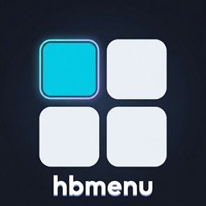

<p align="center">
  
</p>

<h1 align="center">Homebrew Menu — Switch 2 HOME UI</h1>

<p align="center">
  A Nintendo Switch 2 HOME-style frontend for <strong>ounce-hbmenu</strong> (Switch 2 / kaiHEN), rendered natively on the GPU via Vulkan (OunceVK) at 1080p handheld and up to 4K docked at 60 fps.
</p>

---

## Screenshots

| Basic Dark (Carousel) | Basic Light (Pill Focus) |
| :---: | :---: |
|  |  |
| **All Software (Grid)** | **Switch 2 Settings** |
|  |  |

---

## Features

* **Authentic Switch 2 HOME Layout**
  * **1-Row Carousel** with large rounded app tiles, soft elevation shadows, elastic selection pop, and a **360° continuous iridescent focus border** (`256×256` SDF ring).
  * **All Software Grid** (5-column scrollable grid) accessible from the end of the carousel or the bottom pill bar.
  * **Interactive Bottom Pill Bar** with clean vector/SDF icons for **Netloader**, **Favorites** (quick filter), **All Software**, **Themes**, **Settings**, and **Exit**.
  * **Clean Switch 2 HUD**: circular header badge, clock (`HH:MM`), accurate **Wi-Fi / Airplane Mode** detection, horizontal live battery indicator, and Joy-Con P1 footer icon.
* **Full-Screen Switch 2 Settings**
  * **UI Sounds**: On / Off (ultra-discreet tactile Switch 2 micro-ticks via non-blocking `audout`).
  * **Theme**: Auto (System) / Basic Light / Basic Dark — while preserving compatibility with standard `nx-hbmenu` `.cfg` themes via the Theme Menu (`-`).
  * **Focus Border Speed**: Slow / Normal / Fast / Static.
  * **Transitions**: Slide & Fade / Fade / Instant.
  * **Default View**: Carousel / All Software.
  * **Sort Order**: Favorites First / Alphabetical.
  * **Show Author & Version**: On / Off.
* **Full Gamepad & Touchscreen Support**
  * Horizontal touch drag on the carousel, tap to select/launch, tap pill icons directly, and touch navigation in Settings.
* **Non-Destructive Configuration**
  * Settings are stored in a dedicated file (`sdmc:/config/nx-hbmenu/switch2_settings.cfg`) and never touch upstream `nx-hbmenu`'s `settings.cfg`.

---

## Controls

| Input | Action |
| :--- | :--- |
| **D-Pad / Left Stick** | Navigate apps, grid, pill bar, or settings |
| **Down** *(on carousel / last grid row)* | Move focus to the bottom pill bar |
| **Up / B** *(on pill bar)* | Return focus to apps |
| **A** | Launch app / Open folder / Apply theme / Select pill item |
| **B** | Back (exit Settings, Grid, Favorites filter, Theme Menu, or subfolder) |
| **X** | Star / Unstar favorite app |
| **Y** | Start Netloader (`nxlink`) |
| **- (Minus)** | Open Theme Menu |
| **ZL / ZR** | Fast page jump |
| **+ (Plus)** | Exit Homebrew Menu |

---

## Installation (Switch 2 / kaiHEN)

1. Download the latest `hbmenu.nro` from the [Releases](https://github.com/ImDella/Switch2-HBmenu-Home/releases/latest) page.
2. Back up your existing `sdmc:/hbmenu.nro` (e.g. rename it to `hbmenu_backup.nro`).
3. Copy the new `hbmenu.nro` to the root of your microSD card (`sdmc:/hbmenu.nro`).
4. Launch any game while holding **`R`** under **kaiHEN** to boot into Homebrew Menu.

---

## Building from Source

Requires **devkitPro** (`devkitA64`) with the **[ounce-devkit](https://github.com/ouncebrew/ounce-devkit)** (`libounce`, `ouncevk`, `libkaihen`), **Python 3**, and **`glslangValidator`** (`glslang`).

### Required `dkp-pacman` packages
* `switch-dev`
* `switch-freetype`
* `switch-libconfig`
* `switch-libjpeg-turbo`
* `switch-physfs`

### Compile
From the repository root:

```sh
make -f switch2/Makefile
```

The compiled binary is written to `build/nro/nro/hbmenu.nro`.

Alternatively, build inside Docker using the included `Dockerfile`:

```sh
docker build --output out .
```

---

## Credits

* **Switch 2 HOME UI, Settings & Tactile SFX:** [ImDella](https://github.com/ImDella)
* **Switch 2 Vulkan Port (`ounce-hbmenu`):** [ouncebrew](https://github.com/ouncebrew/ounce-hbmenu)
* **Original `nx-hbmenu`:** [switchbrew](https://github.com/switchbrew/nx-hbmenu) (based on 3DS [new-hbmenu](https://github.com/fincs/new-hbmenu) by fincs)
* **Libraries:** `nanosvg` (zlib license), `libjpeg-turbo`, `libconfig`, `freetype2`, `physfs`

## Disclaimer

This software is provided **"as is"**, without warranty of any kind. **Use it at your own risk** — I am not responsible for any damage, data loss, bans, or issues that may occur from using this homebrew application. Always keep a backup of your original `hbmenu.nro` and important SD card files.

This project is an unofficial community modification and is not affiliated with, endorsed by, or associated with Nintendo. Parts of the UI code, design, and documentation were developed with the assistance of AI tools.

## License

This project is licensed under the **ISC License** — see [LICENSE.md](LICENSE.md) for details.
